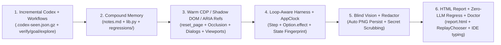

# Brain Autopilot (`brain-autopilot`)

[](https://antigravity.google)
[](https://github.com/baehaqi-rf/brain-autopilot/actions/workflows/ci.yml)
[](CHANGELOG.md)
[](LICENSE)

**Brain Autopilot v3.1** is a continually learning, zero-dependency autonomous verification, exploration, regression replay, and playtesting engine for **Web Apps (Next.js / React / Astro / Vite)**, **Mobile Apps (Expo / React Native / Flutter / Android ADB)**, and **3D/WebGL Apps (Three.js / React Three Fiber / Shaders)**.

Benchmarked against [`ramenvr/autopilot`](https://github.com/ramenvr/autopilot), [`microsoft/playwright-mcp`](https://github.com/microsoft/playwright-mcp), [`browserbase/stagehand`](https://github.com/browserbase/stagehand), [`browser-use/browser-use`](https://github.com/browser-use/browser-use), and [`mobile-dev-inc/Maestro`](https://github.com/mobile-dev-inc/Maestro), `brain-autopilot` executes real browser CDP and Android ADB runs inside **Google Antigravity** (companion runtime to [`baehaqi-rf/opus-maxx`](https://github.com/baehaqi-rf/opus-maxx)).

---

## Architecture & Upgraded v3.1 Pillars



| Pillar | Module | What It Does |
| :--- | :--- | :--- |
| **1. Incremental Codex & Workflows** | [`codex.py`](brain_autopilot/codex.py), [`workflows.py`](brain_autopilot/workflows.py) | SHA-256 diffs across runs + kind-specific workflows (`verify.md`, `goal.md`, `explore.md`) with per-project overrides. |
| **2. Compound Memory & Zero-LLM Regress** | [`memory.py`](brain_autopilot/memory.py), [`regress.py`](brain_autopilot/regress.py) | Persists `notes.md`, `lib.py`, `runs/`, and auto-saved `regressions/` replayed deterministically without an LLM (`brain-autopilot regress`). |
| **3. Warm Shared CDP / Shadow DOM / ADB / WebGL** | [`engines/cdp.py`](brain_autopilot/engines/cdp.py), [`web.py`](brain_autopilot/engines/web.py), [`mobile.py`](brain_autopilot/engines/mobile.py), [`webgl3d.py`](brain_autopilot/engines/webgl3d.py) | Pure-stdlib RFC 6455 Chrome/Edge CDP with open **Shadow DOM piercing**, Playwright-style **ARIA `[ref=eN]` snapshots**, `elementFromPoint` **occlusion guard**, non-deadlocking **JS dialog handler**, responsive **`set_viewport` presets**, real **network-idle `wait_settled()`**, `contenteditable` support, live Android `adb`, and WebGL/3D probes. |
| **4. Bug, A11y & Perf Detectors** | [`detectors.py`](brain_autopilot/detectors.py) | Detects console/hydration/unhandled-rejection errors, 4xx/5xx & slow network requests, blocking JS dialogs, occluded interactive controls, CLS > 0.1, desktop/mobile horizontal overflow, `<44x44px` touch targets, broken images, WCAG missing `alt`, unlabeled controls (with `<label for>`/`aria-labelledby`), duplicate IDs, large DOM, slow LCP, and blank/low-FPS 3D canvases with `detectors.json` mute rules. |
| **5. Loop-Aware Harness, `AppClock` & Reviewer** | [`kit/`](brain_autopilot/kit/harness.py), [`runtime.py`](brain_autopilot/runtime.py), [`episode-reviewer.md`](agents/episode-reviewer.md) | `Step` + `Option(effect=...)`, `AppClock`, observation-fingerprint **no-op loop escape**, persisted episode PNG frames, compact `traceN_summary.txt`, `restart=False` stall continuation, and `episode-reviewer` subagent diagnosis. |
| **6. Blind Vision, HTML Reports, Doctor & Bench** | [`vision.py`](brain_autopilot/vision.py), [`report_html.py`](brain_autopilot/report_html.py), [`doctor.py`](brain_autopilot/doctor.py), [`bench.py`](brain_autopilot/bench.py) | Auto-recorded frames for `describe_frames`, portable dark-mode `report.html` (with real decision timelines & embedded PNGs), `doctor --fix` for Pyrefly/Pyright IDE typing, and the 12-task `brain-autopilot bench` suite. |

---

## v2.0 vs v3.0 vs v3.1 Benchmark (Live Chrome CDP)

| Benchmark Task | v2.0 (Cold CDP) | v3.0 (Warm CDP) | v3.1 (Benchmark Boost) | Benchmark Origin |
| :--- | :---: | :---: | :---: | :--- |
| `W1_checkout_and_regress` | `16.28s` | `6.40s` | `3.54s` | `ramenvr/autopilot` |
| `W2_bug_detectors_and_mute` | `5.66s` | `0.94s` | `0.77s` | `ramenvr/autopilot` |
| `W3_a11y_and_perf_detectors` | — | `0.75s` | `0.57s` | Lighthouse / WCAG |
| `W4_session_reuse_isolation` | — | `1.48s` | `1.00s` | Warm CDP pool (`reset_page` fix) |
| `W5_shadow_dom_and_aria_refs` | — | — | `0.62s` | `microsoft/playwright-mcp` & `stagehand` |
| `W6_dialog_and_occlusion_guard` | — | — | `0.87s` | `microsoft/playwright-mcp` actionability |
| `W7_responsive_viewport_and_network_idle` | — | — | `0.87s` | Playwright emulation & network-idle |
| `D1_webgl3d_canvas_health` | `2.97s` | `1.15s` | `0.70s` | 3D/WebGL probe |
| `R1_state_loop_escape_and_html_fidelity` | — | — | `0.15s` | `browser-use` / WebArena anti-looping |
| **Suite Score** | **5 / 5 (100%)** | **8 / 8 (100%)** | **12 / 12 (100%, 10.79s)** | **+4 new v3.1 suites** |

---

## Quick Start & Installation

### Windows PowerShell

```powershell
git clone https://github.com/baehaqi-rf/brain-autopilot.git "$HOME\.gemini\brain-autopilot"
& "$HOME\.gemini\brain-autopilot\install.ps1"
```

### Linux / macOS / Cloud Shell

```bash
git clone https://github.com/baehaqi-rf/brain-autopilot.git ~/.gemini/brain-autopilot
bash ~/.gemini/brain-autopilot/install.sh
```

---

## CLI & MCP Usage

```bash
# 1. Index a project and see what changed since the last run:
brain-autopilot codex /path/to/your-app

# 2. Dry-run a harness (setup + initial observe + each legal Option once):
brain-autopilot check harness.py --project /path/to/your-app --url http://localhost:3000

# 3. Execute an autonomous verification episode (and resume without restart if stalled):
brain-autopilot run harness.py --project /path/to/your-app --url http://localhost:3000 --seconds 30
brain-autopilot run harness.py --project /path/to/your-app --url http://localhost:3000 --no-restart

# 4. Replay deterministic saved regressions without calling an LLM:
brain-autopilot regress /path/to/your-app --url http://localhost:3000

# 5. Manage bug detectors (mute false positives or toggle enabled):
brain-autopilot detectors /path/to/your-app --mute "network_error:404:/favicon.ico"

# 6. Run the built-in Web CDP + Detectors + Mobile + 3D + Regression benchmark suite:
brain-autopilot bench

# 7. Inspect or atomically reset learned memory:
brain-autopilot memory /path/to/your-app
brain-autopilot memory /path/to/your-app --forget

# 8. Diagnose IDE/Pyrefly typing, CDP browser, ADB & Antigravity wiring (and auto-fix):
brain-autopilot doctor --fix

# 9. Generate a self-contained dark-mode HTML report for any run directory:
brain-autopilot report-html /path/to/runs/<run_id>

# 10. Start the stdio MCP server:
brain-autopilot mcp
```

---

## Running Tests & Validation

```bash
python tests/run_tests.py
python tests/validate_repo.py
python bench/run_bench.py
```

---

## Contributing

Contributions are welcome! Please read the [Contributing Guide](CONTRIBUTING.md) before opening a pull request, and adhere to our [Code of Conduct](CODE_OF_CONDUCT.md).

For security issues, please follow our [Security Policy](SECURITY.md).

---

## License

MIT License © 2026 [Baehaqi RF](https://github.com/baehaqi-rf).
