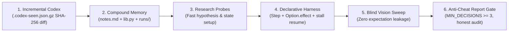

# Brain Autopilot (`brain-autopilot`)

[](https://antigravity.google)
[](CHANGELOG.md)
[](LICENSE)

**Brain Autopilot** is a continually learning, real-time autonomous verification, exploration, and playtesting engine for **Web Apps (Next.js / React / Astro / Vite)**, **Mobile Apps (Expo / React Native / Flutter / Android ADB)**, and **3D/WebGL Apps (Three.js / React Three Fiber / Shaders)**.

Modeled through a ground-truth REA decomposition of [`ramenvr/autopilot`](https://github.com/ramenvr/autopilot), `brain-autopilot` brings the exact 6 engineering pillars that make game playtesting agents improve run after run to modern full-stack web, mobile, and 3D software engineering inside **Google Antigravity** (as a companion runtime to [`baehaqi-rf/opus-maxx`](https://github.com/baehaqi-rf/opus-maxx)).

---

## 🏗️ The 6 Architectural Pillars



| Pillar | Module | What It Does |
| :--- | :--- | :--- |
| **1. Incremental Codex & SHA-256 Diff** | [`brain_autopilot/codex.py`](brain_autopilot/codex.py) | Indexes routes, screens, APIs, schemas, and 3D shaders into `codex/README.md` and stores file hashes in `.codex-seen.json.gz`. Next runs immediately see only what changed since the last run. |
| **2. Compound Project Memory (`notes.md` + `lib.py`)** | [`brain_autopilot/memory.py`](brain_autopilot/memory.py) | Stores verified project facts in `notes.md` and reusable UI controllers in `lib.py` (`import lib`). Includes atomic `forget()` that moves learned files to `.reset-backup/` with rollback on Windows file locks. |
| **3. Two-Stage Execution (`probe` vs `run_harness`)** | [`brain_autopilot/runtime.py`](brain_autopilot/runtime.py) | `probe` mode allows direct state setup (`app.set(..., why=...)`) for fast discovery; `episode` mode (`run_harness`) acts strictly through user inputs (`click`, `fill`, `navigate`, `scroll`) and logs any direct overrides separately. |
| **4. Declarative `Harness`, `Step` & `Option` Contract** | [`brain_autopilot/kit/`](brain_autopilot/kit/harness.py) | Every `Option` defines an `effect(before_obs, after_obs)` check. Multi-step goals use ordered `Step`s whose `done(obs)` reads live app state. Stalled runs pause and resume in place via `run_harness(restart=False)`. |
| **5. Blind Vision Frame Describer** | [`brain_autopilot/vision.py`](brain_autopilot/vision.py) | `describe_frames` strips out the user's request and expected outcome, enforces open non-leading questions, and appends a mandatory visual anomaly `SWEEP` (overflow, clipped text, blank canvas, broken controls). |
| **6. Multi-Engine Adapters + Async Stdio MCP** | [`brain_autopilot/engines/`](brain_autopilot/engines/__init__.py) & [`mcp.py`](brain_autopilot/mcp.py) | Auto-detects `WebEngine` (DOM/Headless Chrome), `MobileEngine` (Android ADB `uiautomator dump` + `44x44px` touch audit), and `WebGL3DEngine` (Three.js/R3F telemetry). Exposes non-blocking MCP (`start_run` / `wait`). |

---

## 🚀 Quick Start & Installation

### 1-Click Install (Windows PowerShell)

```powershell
git clone https://github.com/baehaqi-rf/brain-autopilot.git "$HOME\.gemini\brain-autopilot"
& "$HOME\.gemini\brain-autopilot\install.ps1"
```

Or bootstrap directly via `Invoke-Expression`:

```powershell
Invoke-Expression (Invoke-RestMethod "https://raw.githubusercontent.com/baehaqi-rf/brain-autopilot/main/install.ps1")
```

### Linux / macOS / Cloud Shell

```bash
git clone https://github.com/baehaqi-rf/brain-autopilot.git ~/.gemini/brain-autopilot
bash ~/.gemini/brain-autopilot/install.sh
```

---

## 🛠️ CLI & MCP Usage

```bash
# 1. Index a project and see what changed since the last run:
brain-autopilot codex /path/to/your-app

# 2. Dry-run a harness (setup + initial observe + each legal Option once):
brain-autopilot check harness.py --project /path/to/your-app --url http://localhost:3000

# 3. Execute an autonomous verification episode (and resume without restart if stalled):
brain-autopilot run harness.py --project /path/to/your-app --url http://localhost:3000 --seconds 30
brain-autopilot run harness.py --project /path/to/your-app --url http://localhost:3000 --no-restart

# 4. Inspect or atomically reset a project's learned memory:
brain-autopilot memory /path/to/your-app
brain-autopilot memory /path/to/your-app --forget

# 5. Start the stdio MCP server:
brain-autopilot mcp
```

---

## 🧪 Running Tests & Repository Validation

```bash
pytest -q
python tests/validate_repo.py
```

---

## 📜 License

MIT License © 2026 [Baehaqi RF](https://github.com/baehaqi-rf).
