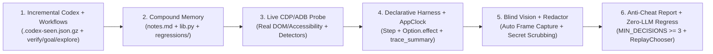

# Brain Autopilot (`brain-autopilot`)

[](https://antigravity.google)
[](CHANGELOG.md)
[](LICENSE)

**Brain Autopilot v2.0** is a continually learning, zero-dependency autonomous verification, exploration, regression replay, and playtesting engine for **Web Apps (Next.js / React / Astro / Vite)**, **Mobile Apps (Expo / React Native / Flutter / Android ADB)**, and **3D/WebGL Apps (Three.js / React Three Fiber / Shaders)**.

Benchmarked against [`ramenvr/autopilot`](https://github.com/ramenvr/autopilot), [`microsoft/playwright-mcp`](https://github.com/microsoft/playwright-mcp), [`browserbase/stagehand`](https://github.com/browserbase/stagehand), [`browser-use/browser-use`](https://github.com/browser-use/browser-use), and [`mobile-dev-inc/Maestro`](https://github.com/mobile-dev-inc/Maestro), `brain-autopilot` executes real browser CDP and Android ADB runs inside **Google Antigravity** (companion runtime to [`baehaqi-rf/opus-maxx`](https://github.com/baehaqi-rf/opus-maxx)).

---

## Architecture & Upgraded v2.0 Pillars



| Pillar | Module | What It Does |
| :--- | :--- | :--- |
| **1. Incremental Codex & Workflows** | [`codex.py`](brain_autopilot/codex.py), [`workflows.py`](brain_autopilot/workflows.py) | SHA-256 diffs across runs + kind-specific workflows (`verify.md`, `goal.md`, `explore.md`) with per-project overrides. |
| **2. Compound Memory & Zero-LLM Regress** | [`memory.py`](brain_autopilot/memory.py), [`regress.py`](brain_autopilot/regress.py) | Persists `notes.md`, `lib.py`, `runs/`, and auto-saved `regressions/` replayed deterministically without an LLM (`brain-autopilot regress`). |
| **3. Zero-Dependency Live CDP / ADB / WebGL** | [`engines/cdp.py`](brain_autopilot/engines/cdp.py), [`web.py`](brain_autopilot/engines/web.py), [`mobile.py`](brain_autopilot/engines/mobile.py), [`webgl3d.py`](brain_autopilot/engines/webgl3d.py) | Pure-stdlib RFC 6455 Chrome/Edge CDP WebSocket automation, React/Vue-safe inputs, live Android `adb` execution, and WebGL/3D canvas probes. |
| **4. Configurable Bug Detectors** | [`detectors.py`](brain_autopilot/detectors.py) | Detects console errors, 4xx/5xx network errors, CLS > 0.1, horizontal overflow, `<44x44px` touch targets, broken images, and blank/low-FPS 3D canvases with `detectors.json` mute rules. |
| **5. Declarative Harness, `AppClock` & Reviewer** | [`kit/`](brain_autopilot/kit/harness.py), [`runtime.py`](brain_autopilot/runtime.py), [`episode-reviewer.md`](agents/episode-reviewer.md) | `Step` + `Option(effect=...)`, `AppClock`, compact `traceN_summary.txt`, `restart=False` stall continuation, and `episode-reviewer` subagent diagnosis. |
| **6. Blind Vision, Redactor & Benchmarks** | [`vision.py`](brain_autopilot/vision.py), [`redact.py`](brain_autopilot/redact.py), [`bench.py`](brain_autopilot/bench.py) | Auto-recorded frame buffer for `describe_frames`, credential/path scrubbing, and built-in `brain-autopilot bench` suite. |

---

## Quick Start & Installation

### Windows PowerShell

```powershell
git clone https://github.com/baehaqi-rf/brain-autopilot.git "$HOME\.gemini\brain-autopilot"
& "$HOME\.gemini\brain-autopilot\install.ps1"
```

### Linux / macOS / Cloud Shell

```bash
git clone https://github.com/baehaqi-rf/brain-autopilot.git ~/.gemini/brain-autopilot
bash ~/.gemini/brain-autopilot/install.sh
```

---

## CLI & MCP Usage

```bash
# 1. Index a project and see what changed since the last run:
brain-autopilot codex /path/to/your-app

# 2. Dry-run a harness (setup + initial observe + each legal Option once):
brain-autopilot check harness.py --project /path/to/your-app --url http://localhost:3000

# 3. Execute an autonomous verification episode (and resume without restart if stalled):
brain-autopilot run harness.py --project /path/to/your-app --url http://localhost:3000 --seconds 30
brain-autopilot run harness.py --project /path/to/your-app --url http://localhost:3000 --no-restart

# 4. Replay deterministic saved regressions without calling an LLM:
brain-autopilot regress /path/to/your-app --url http://localhost:3000

# 5. Manage bug detectors (mute false positives or toggle enabled):
brain-autopilot detectors /path/to/your-app --mute "network_error:404:/favicon.ico"

# 6. Run the built-in Web CDP + Detectors + Mobile + 3D + Regression benchmark suite:
brain-autopilot bench

# 7. Inspect or atomically reset learned memory:
brain-autopilot memory /path/to/your-app
brain-autopilot memory /path/to/your-app --forget

# 8. Start the stdio MCP server:
brain-autopilot mcp
```

---

## Running Tests & Validation

```bash
python tests/run_tests.py
python tests/validate_repo.py
python bench/run_bench.py
```

---

## License

MIT License © 2026 [Baehaqi RF](https://github.com/baehaqi-rf).
